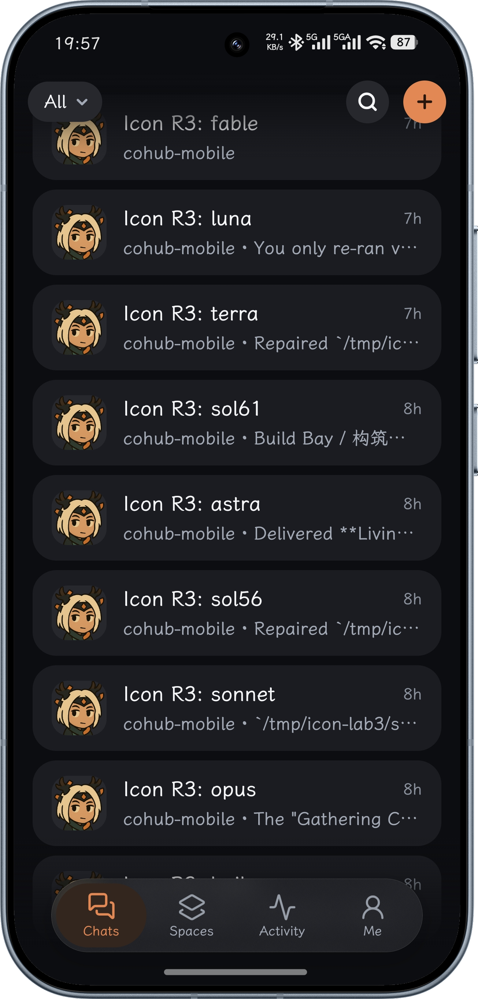
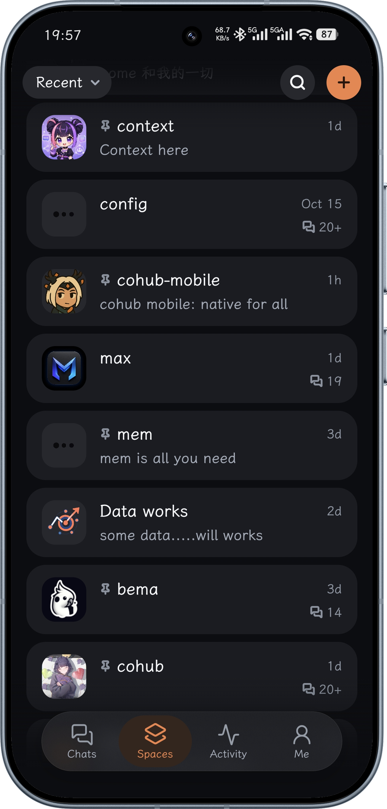
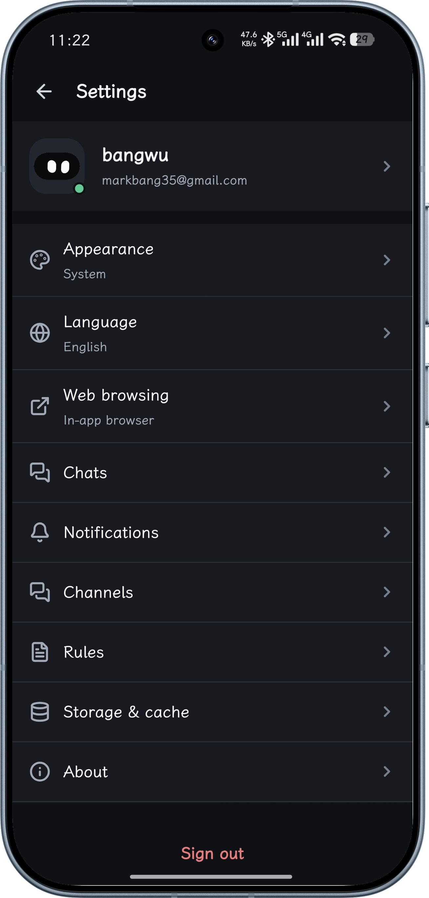

# Cohub Mobile

A native iOS and Android client for Cohub, built with React Native and Expo.

  
  &nbsp;&nbsp;
  
  &nbsp;&nbsp;
  

## Download

| Platform | Link |
|----------|------|
| **Android** | [Download APK](https://cohub.live/bangwu/cohub-mobile/w/download) · [all builds](https://github.com/markbang/cohub-mobile/releases) |
| **iOS** | [Join the TestFlight beta](https://testflight.apple.com/join/KWhztpkP) |

Android builds are published per ABI to the Yaota distribution origin, which is what the in-app updater reads. The [download page](https://cohub.live/bangwu/cohub-mobile/w/download) resolves the newest `arm64-v8a` build, and falls back to GitHub Releases if the catalog is unreachable.

iOS ships through TestFlight while the app is in beta. Install the Apple TestFlight app first, then open the invite link above.

## Included

The app uses native screens for Chats, Spaces, Activity, Profile, session timelines, files, and settings. Published HTML/Work previews are opened in a constrained WebView because their content is inherently web-based.

- Native Chats inbox with paginated cross-Space selection, search, running/attention filters, optimistic sends, stop, rename, attachments, camera, photo library, and live Cohub stream patches
- Turn-based Chat history with older/newer pagination, searchable turn navigation, direct window jumps, and stable scroll position
- Model picker with availability lights, provider/context metadata, and per-model thinking levels
- Native PCM voice input connected to Cohub ASR
- Spaces with Chats, Files, Saves, Works, and Task Runs
- Native file viewer plus constrained WebView for published Works
- Activity and usage overview
- Native Settings sections for Profile, Appearance, Activity, Notifications, Rules, Channels, Billing, and Referrals
- Cache-first SQLite hydration, reconnect reconciliation, and user-scoped cache clearing
- Android device Runtime: create a Space on this device or connect an existing one, so agents work directly in a phone folder (Android 11+, 64-bit; asks for All files access)
- Android screen sharing: share this phone's screen with a Space it serves so people can watch and steer it from the web and agents can use it; control needs Cohub enabled in Accessibility
- Native Logto PKCE, `cohub://` deep links, notification tap routing, APNs/FCM token acquisition, and GitHub-native build profiles

## Deployment endpoints

The login screen can select production or development and remembers the choice. `EXPO_PUBLIC_COHUB_ENV`
sets the build-time default; optional endpoint overrides are documented in `.env.example`.

| Environment | API | Gateway |
|-------------|-----|---------|
| Production | `https://capi.neta.art` | `wss://cgateway.neta.art/ws` |
| Development | `https://capi-dev.neta.art` | `wss://cgateway-dev.neta.art/ws` |

These accelerated origins serve the same deployments. Authentication endpoints, Logto App IDs, the
OAuth resource identifier (`https://api.talesofai`), and public/deep-link origins are unchanged.

## Android device Runtime policy

The Android module owns system services, permissions, and their required notifications. Product policy
is set through `src/platform/device-runtime.ts`, not hardcoded into service lifecycle callbacks.

- `setDeviceControlKeepAliveEnabled(boolean)` persists and applies optional foreground keep-alive
  while Accessibility is enabled and no Space is connected. `isDeviceControlKeepAliveEnabled()` reads
  the current native value. Both require a supported Android device Runtime.
- JS startup currently sets this policy to `false`, including before sign-in. Native defaults to
  `false` and retains the last configured value across process restarts, so Accessibility can start
  without JS. This is device-wide policy, not account data; sign-out does not change it.
- Disabling it leaves Accessibility enabled and removes the idle foreground notification. Connected
  Spaces and screen sharing still keep their required foreground service and notification. Optional
  keep-alive improves process priority but cannot guarantee survival on every Android ROM.
- After installing a native build containing this interface, changing the JS startup value or wiring
  these methods to a setting can ship through a compatible OTA. The value changes when that JS runs;
  downloading an OTA alone does not update native preferences. New permissions, system capabilities,
  dependencies, and native implementation fixes still require a new APK.

## Accent color

Settings > Appearance offers eight accent presets (`src/design/accents.ts`), stored per device. Each
preset is tuned for light and dark and replaces only the accent and own-message bubble tokens, so pure
black and the rest of the palette stay unchanged. The mobile app no longer reads the Config Space
`.cohub/theme.css`.

## Thanks

[Cohub](https://github.com/talesofai/cohub)
